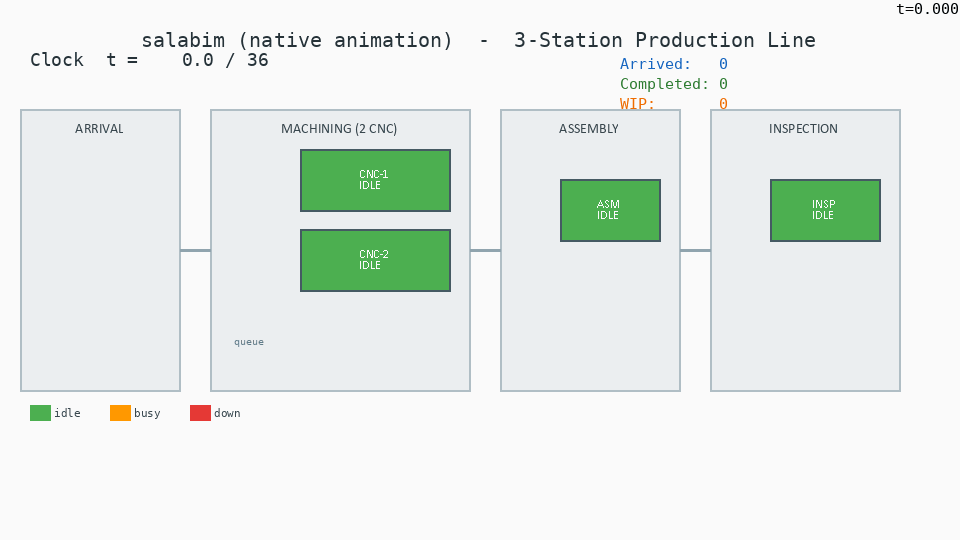
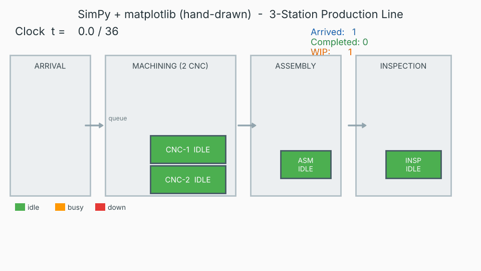

# 车间仿真对比 demo：salabim 原生动画 vs SimPy 手画渲染

> 原型 / 选型评估（prototype / eval），用于为"车间仿真工具链"做技术选型，**不是最终集成代码**。

同一个三工位产线场景，分别用两种方式实现并渲染成 GIF，便于直观对比两种仿真引擎在"做可视化动画"上的差异：

- `line_salabim.py` —— 用 [salabim](https://www.salabim.org/) 的**原生 2D 动画引擎**。
- `line_simpy.py` —— 用 [SimPy](https://simpy.readthedocs.io/) 跑模型，再用 matplotlib **逐帧手画** + Pillow 拼接成 GIF。

## 共享场景

三工位流水线（带排队）：

```
零件到达  ->  机加工 (2×CNC)  ->  装配 (1)  ->  检验 (1)
```

- **零件到达**：指数分布，间隔均值 ≈ 4
- **机加工**：2 台 CNC，加工时间 ≈ 6
- **装配**：1 个工位，装配时间 ≈ 5
- **检验**：1 个工位，检验时间 ≈ 3
- 每个工位前都有**排队**（资源忙时零件排队等待）
- **故障注入**：`t = 18` 时一台 CNC 发生故障（显示为红色 "DOWN"），`t = 28` 恢复上线
- **仿真时长（horizon）**：`t = 36`

## 运行结果

### salabim（原生动画）



### SimPy（matplotlib 手画逐帧）



## 如何运行

### salabim

salabim 即使做无头视频导出也会构建 Tk root 并 import `PIL.ImageTk`，所以需要一个显示环境（用 `xvfb-run`）、`python3-tk` 以及自带 `ImageTk` 的 Pillow。需要 **python3.12 + tkinter**：

```bash
xvfb-run -a python3.12 line_salabim.py
```

### SimPy

SimPy 版本用 matplotlib 的 **Agg** 后端（无需显示），直接用 `python3` 运行即可：

```bash
python3 line_simpy.py
```

## 关键结论

- **salabim 自带 2D 动画**：用内置的 `AnimateQueue`、矩形、文本等图元就能直接把队列、资源、零件画出来，动画是引擎原生能力，代码量小。
- **SimPy 没有内置动画**：需要用 matplotlib **逐帧手画**每一帧（资源、队列、零件、故障状态都要自己画），再用 Pillow 把帧拼接成 GIF，**代码量大得多**。

## 说明

两次运行使用**各自独立的随机数发生器（RNG）**，因此两个 GIF 里的吞吐量计数会不一样——这是**同一个模型、不同的随机抽样**导致的，并非模型逻辑不一致。
